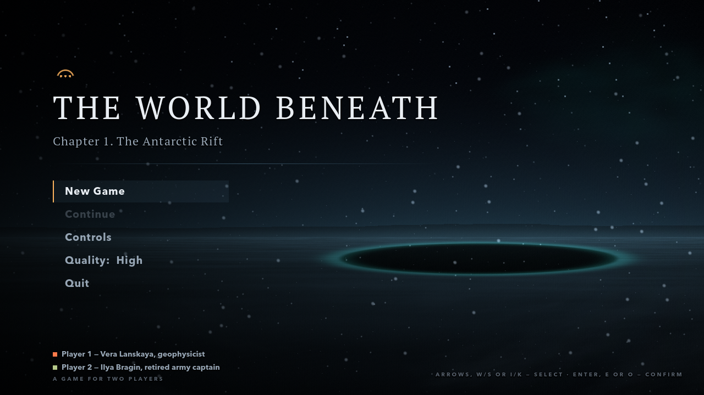
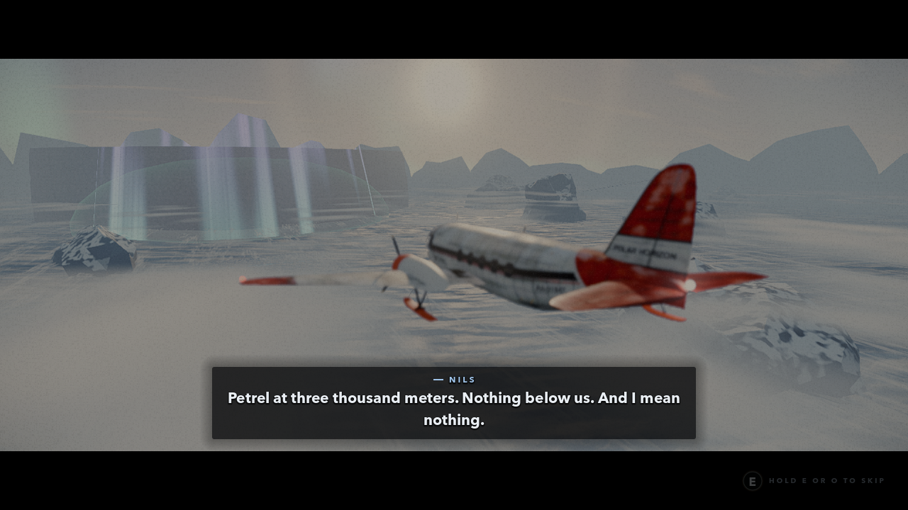

# The World Beneath

A two-player local co-op adventure in third person with a split screen.
Geophysicist Vera Lanskaya and retired army captain Ilya Bragin crash in Antarctica and fall into a hidden world beneath the ice.

This is Chapter 1, “The Antarctic Rift”. It takes about 10–20 minutes to play through. The game is in English.





## Download

**[Download for Mac (latest version)](https://github.com/artyakim/the-world-beneath/releases/latest/download/TheWorldBeneath-mac.zip)**

Runs on Apple Silicon Macs (macOS 13 or later) and Intel Macs (macOS 11 or later). It has been tested on Apple Silicon only. There is no Windows version yet.

## How to run it on a Mac

1. Double-click the archive to unpack it and move “The World Beneath” to the Applications folder.
2. Launch the app. It is not signed with an Apple developer certificate, so on the first launch macOS shows a warning and refuses to open it. Click “Done”.
3. Open System Settings → Privacy & Security, scroll down, and click “Open Anyway” next to the name of the game.
4. From then on the app opens with a normal double-click.

Instead of steps 2–3 you can run this once in Terminal:

```bash
xattr -dr com.apple.quarantine "/Applications/The World Beneath.app"
```

**The first start is slow.** After you choose “New Game”, the game spends several minutes preparing its graphics: about 4.5 minutes on a MacBook Pro with an M1 Pro, longer on less powerful Macs. A progress bar with a percentage stays on screen the whole time, so the game has not frozen. Every later start takes about 20 seconds.

Saves from versions 0.1 and 0.2 are not carried over: the game was renamed, so it starts from the beginning.

## Controls

The game is made for two players. You can share one keyboard or connect gamepads: the first gamepad controls Vera, the second controls Ilya. Ilya has two keyboard layouts, and both work at the same time.

| Action | Vera (player 1) | Ilya, laptop | Ilya, full keyboard | Gamepad |
|---|---|---|---|---|
| Move | W A S D | I J K L | Arrow keys | Left stick |
| Camera | Z X / R F | M , / P ; | Num4 Num6 / Num8 Num5 | Right stick |
| Jump | Space | Enter | Num0 | A |
| Interact | E | O | Num2 | X |
| Ability | Q (scanner) | U (flashlight, flare) | Num3 | Y |
| Crouch | C | . | Num1 | B |
| Sprint | Left Shift | N | Right Shift | LB / L3 |
| Journal | Tab | Y | Num9 | Back |
| Pause | Esc | Esc | Esc | Start |

The same table is in the game under “Controls”. Graphics quality is switched in the main menu.

## What's new in 0.3

- The whole game is in English: dialogue, journal, interface, hints, and the lettering on objects.
- The opening flight and the crash site use new models: the Petrel aircraft, its wreckage, ice, crates, and barrels.
- Vera and Ilya wear new polar clothing.
- The camera in the opening film no longer shakes, and the aircraft flies steadily.
- The giant no longer carries a staff, and it walks with more weight.

## Credits

- Engine: [Godot 4.7](https://godotengine.org) (MIT license).
- Aircraft, wreckage, ice, gear, and the heroes' clothing are modeled in Blender.
- Character bodies and animation: [Quaternius](https://quaternius.com), CC0.
- Textures: [ambientCG](https://ambientcg.com) and [Poly Haven](https://polyhaven.com), CC0.
- Music and sound effects are synthesized when the game starts.

---

## По-русски

Кооперативная приключенческая игра на двоих за одним компьютером: вид от третьего лица, разделённый экран. Геофизик Вера Ланская и военный Илья Брагин терпят крушение в Антарктиде и проваливаются в скрытый мир под льдом. Это первая глава, прохождение занимает 10–20 минут. Начиная с версии 0.3 игра на английском языке.

**[Скачать для Mac (последняя версия)](https://github.com/artyakim/the-world-beneath/releases/latest/download/TheWorldBeneath-mac.zip)**

1. Распакуйте архив и перенесите «The World Beneath» в папку «Программы».
2. Запустите приложение. Оно не подписано сертификатом разработчика Apple, поэтому macOS покажет предупреждение и не откроет его. Нажмите «Готово».
3. Откройте «Системные настройки» → «Конфиденциальность и безопасность», прокрутите вниз и нажмите «Всё равно открыть» рядом с названием игры.

**Первый запуск долгий.** После «New Game» игра несколько минут готовит графику: около 4,5 минуты на MacBook Pro с M1 Pro, на менее мощных Mac дольше. На экране видны полоса и процент — это не зависание. Со второго раза игра запускается примерно за 20 секунд.

Сохранения версий 0.1 и 0.2 не переносятся: игра начнётся сначала. Управление — в таблице выше и в самой игре, в разделе «Controls».
