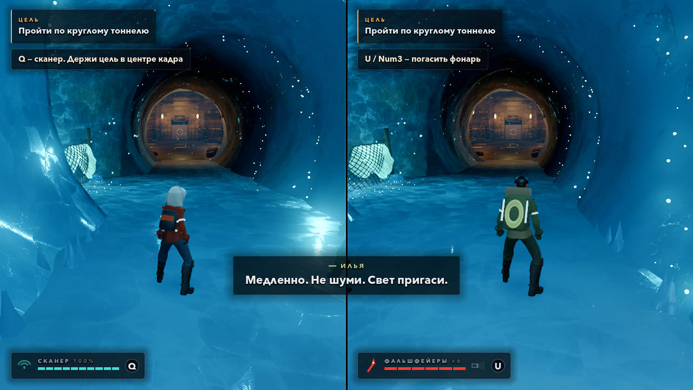
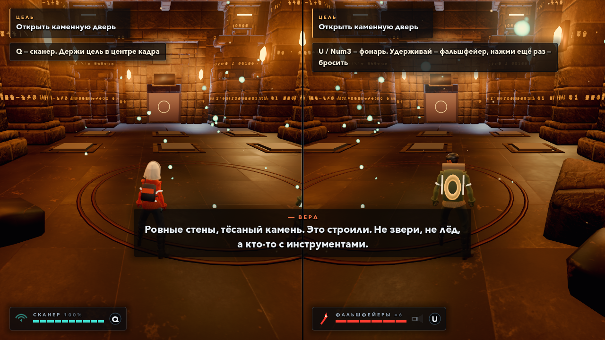

# Изнанка Земли / The World Beneath

Кооперативная приключенческая игра на двоих за одним компьютером, вид от третьего лица, разделённый экран.
Геофизик Вера Ланская и военный Илья Брагин терпят крушение в Антарктиде и проваливаются в скрытый мир под льдом.

Это первая глава — «Антарктический разлом». Прохождение занимает примерно 10–20 минут.





## Скачать

**[Скачать для Mac (последняя версия)](https://github.com/artyakim/the-world-beneath/releases/latest/download/TheWorldBeneath-mac.zip)**

Подходит для Mac на Apple Silicon (macOS 13 и новее) и на Intel (macOS 11 и новее). Проверялась только на Apple Silicon. Версии для Windows пока нет.

## Как запустить на Mac

1. Распакуйте архив двойным щелчком и перенесите «Изнанка Земли» в папку «Программы».
2. Запустите приложение. Оно не подписано сертификатом разработчика Apple, поэтому при первом запуске macOS покажет предупреждение и не откроет его. Нажмите «Готово».
3. Откройте «Системные настройки» → «Конфиденциальность и безопасность», прокрутите вниз и нажмите «Всё равно открыть» рядом с названием игры.
4. Дальше приложение запускается обычным двойным щелчком.

Вместо шагов 2–3 можно один раз выполнить в Терминале:

```bash
xattr -dr com.apple.quarantine "/Applications/Изнанка Земли.app"
```

## Управление

Игра рассчитана на двоих. Можно играть вдвоём на одной клавиатуре или подключить геймпады: первый управляет Верой, второй — Ильёй.

| Действие | Вера (игрок 1) | Илья (игрок 2) |
|---|---|---|
| Движение | W A S D | I J K L или стрелки |
| Прыжок | Пробел | Enter |
| Действие | E | O |
| Способность | Q — сканер | U — фонарь и фальшфейер |
| Присесть | C | . |
| Бег | левый Shift | N |
| Журнал | Tab | Y |
| Поворот камеры | Z / X | M / , |

Пауза — Esc. Качество графики переключается в главном меню.

## Из чего сделано

- Движок: [Godot 4.7](https://godotengine.org) (лицензия MIT).
- Модели и анимации персонажей: [Quaternius](https://quaternius.com), CC0.
- Текстуры: [ambientCG](https://ambientcg.com) и [Poly Haven](https://polyhaven.com), CC0.
- Звук и музыка создаются в игре программно.

---

## English

A two-player local co-op third-person adventure with split screen. A geophysicist and a soldier crash in Antarctica and fall into a hidden world beneath the ice. This is chapter one, roughly 10–20 minutes long. The game is in Russian.

**[Download for Mac](https://github.com/artyakim/the-world-beneath/releases/latest/download/TheWorldBeneath-mac.zip)** (Apple Silicon: macOS 13+, Intel: macOS 11+; tested on Apple Silicon only).

The app is not signed with an Apple developer certificate. On first launch macOS will block it: open System Settings → Privacy & Security and click “Open Anyway”.
